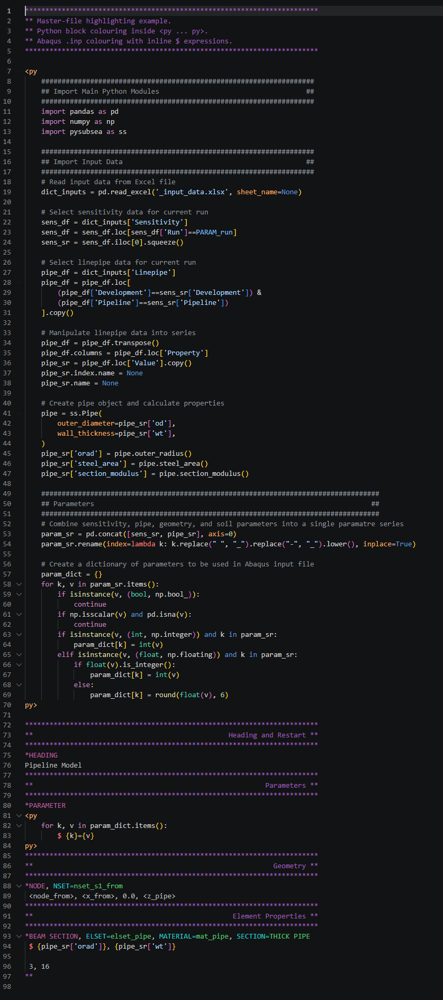
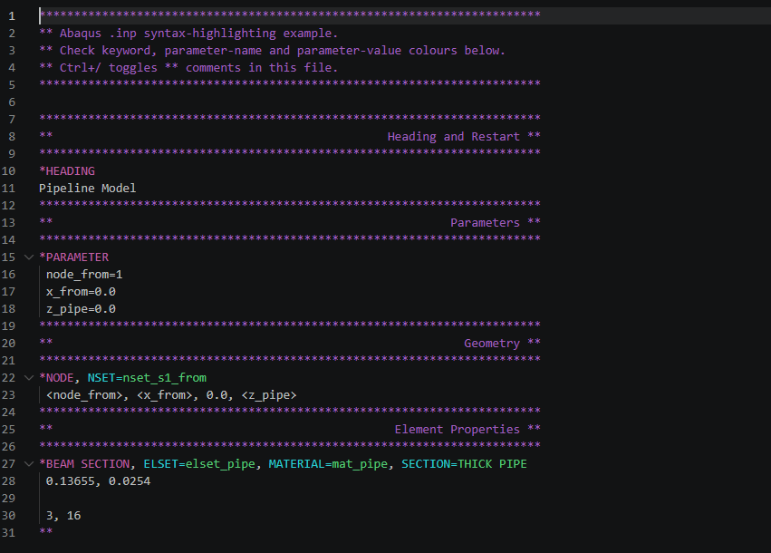
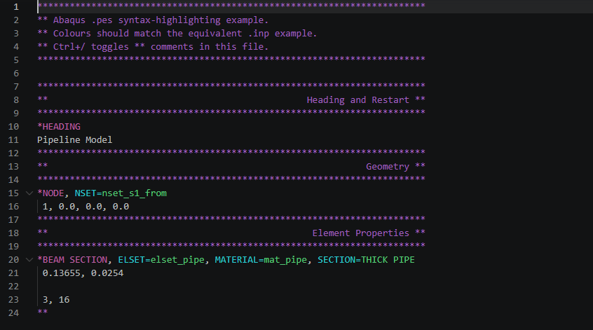

# AbaqusPy: Input File Syntax Highlighter for Abaqus

AbaqusPy is an open-source framework, distributed as part of [PySubsea](https://pypi.org/project/pysubsea/), for extending Abaqus `.inp` workflows with lightweight Python integration.

This Visual Studio Code extension provides syntax highlighting for Abaqus input files (`.inp` and `.pes`), including standard Abaqus syntax and AbaqusPy extensions.

## AbaqusPy Syntax Extensions

AbaqusPy extends the standard Abaqus `.inp` syntax with:

- `<py` and `py>` blocks for embedded Python logic, including loops, calculations, and variable definitions.
- `$` output markers for inserting Python-generated content into the final executable Abaqus `.inp` file

## Features

- Highlights Abaqus keywords and directives (e.g. `*NODE`, `*ELEMENT`, etc.).
- Highlights Python syntax highlighting inside AbaqusPy `<py` and `py>` blocks.
- Highlights AbaqusPy `$` output markers and the Abaqus syntax following them, both inside and outside `<py` ... `py>` blocks.
- Highlights Python `{...}` expressions consistently in output lines and parameter values, such as `surf_sleeper_{i+1}`.
- Supports `Ctrl+/` to toggle Python `#` comments inside `<py` ... `py>` blocks and Abaqus `**` comments outside them in `.inp` and `.pes` files.
- Improves readability of complex `.inp` and `.pes` files used in automation and parametric workflows.

## Syntax Colors

Supports syntax highlighting for light and dark themes.

## Preview

#### Python Blocks, Inline `$` Output, and Abaqus `.inp` Syntax:

#### Abaqus `.inp` Syntax Highlighting:

#### Abaqus `.pes` Syntax Highlighting:

## Extension Details

- **Publisher:** Subsea Energies (https://www.subseaenergies.com)
- **Publisher ID:** `ismaelripoll`
- **Extension ID:** `ismaelripoll.syntax-highlighter-for-abaqus-input-files`
- **Maintained by:** Subsea Energies (https://www.subseaenergies.com)

## Related Framework

This extension does not require PySubsea or a Python interpreter. It uses VS Code's built-in Python grammar for embedded Python highlighting.

AbaqusPy integrates with the open-source PySubsea framework for executing parametric workflows:

- PySubsea (PyPI): https://pypi.org/project/pysubsea/
- PySubsea repository: https://github.com/py-subsea/py-subsea
- PySubsea documentation: https://py-subsea.github.io/py-subsea/

## License

This extension is licensed under the MIT License (see [LICENSE](./LICENSE)).

## Security and Privacy

- This extension is grammar-only and provides syntax highlighting.
- It does not execute scripts or run code on your files.
- It does not collect telemetry.
- It does not make network calls.

## Trademark Notice

This extension is an independent open-source project and is not affiliated with, endorsed by, or sponsored by Dassault Systèmes. Abaqus is a trademark of Dassault Systèmes.
